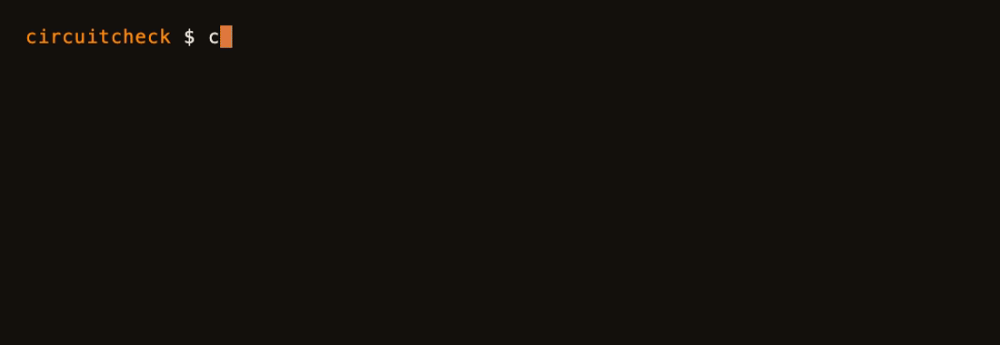

# circuitcheck

[](https://pypi.org/project/circuitcheck/) [](https://pypi.org/project/circuitcheck/) [](https://github.com/albertlieyingadrian/circuitcheck/actions/workflows/ci.yml) [](LICENSE)

<p align="center"></p>

**Test what an attribution graph claims.** circuitcheck is a set of tools on top of
[circuit-tracer](https://github.com/decoderesearch/circuit-tracer) attribution graphs:

| Tool | Question it answers | Runs without a GPU on |
|---|---|---|
| `circuitcheck validate` | Is a group of graph features a **switch** (it causes the behaviour) or a **readout** (it only reflects it)? | the built-in toy model |
| `circuitcheck diff` | Which features and edges did fine-tuning or RL add or remove, and is the change real? | saved graph summaries |
| `circuitcheck label` | What does each feature do, in a few words, and how far can that label be trusted? | cached model replies |
| `circuitcheck lens` | Does a unit's lens read (logit lens or R-lens) predict what steering it does, better than random units of its layer? Does its label name either? | a toy model |
| `circuitcheck edges` | Do the graph's edges follow the model's whole-model wiring (neuron-lens's catalog), more than rewired graphs do? | a toy catalog |
| `circuitcheck neurons validate\|label\|diff` | The same three questions on the model's raw MLP neurons and their subcircuits, with no transcoders | a planted toy transformer |

**Docs: [circuitcheck.mintlify.site](https://circuitcheck.mintlify.site)** · ▶ [Watch the 2.5-minute walkthrough](docs/videos/walkthrough.mp4) ·
[Use cases](https://circuitcheck.mintlify.site/use-cases) · [circuitcheck vs circuit-tracer](https://circuitcheck.mintlify.site/vs-circuit-tracer)

It grew out of [steerlab's circuits episodes](https://albertlieyingadrian.github.io/steerlab/experiments/#circuits).
In [a password lock](https://albertlieyingadrian.github.io/steerlab/experiments/lock-circuit/report/) and
[an RL reward hack](https://albertlieyingadrian.github.io/steerlab/experiments/rl-hack-circuit/report/), the graph's
most influential features all turned out to be readouts. circuitcheck turns the checks behind that finding into
reusable code.

## Install

```bash
pip install circuitcheck
# real models: circuit-tracer from GitHub, plus torch
pip install "git+https://github.com/decoderesearch/circuit-tracer"
# labels: pip install "circuitcheck[anthropic]" (Claude Haiku 5.5, the default) or "[openai]"
# raw MLP neurons, no transcoders: pip install "circuitcheck[neurons]" (neuronkit, torch, transformers)
```

## Five-minute tour (no GPU, no key)

```bash
circuitcheck validate --demo --html validate.html
circuitcheck diff examples/data/rl_hack_graphs.json.gz --before installed/before --after installed/after \
  --control-before control/before --control-after control/after --html diff.html
```

```python
from circuitcheck.validate import logit_diff, validate
from circuitcheck.validate.toy import demo, demo_nodes

backend = demo()
metric = logit_diff(backend.token_id(" Austin"), backend.token_id(" Sacramento"))
report = validate(backend, "dallas", demo_nodes(backend), metric=metric, counterfactual="oakland")
print([(g.name, g.verdict.value) for g in report.groups])
# [('top-5', 'switch'), ('L5/100@5', 'switch'), ('L7/200@5', 'readout'), ('L8/201@5', 'readout'), ...]
```

On a real model, `circuitcheck.tracer.TracerBackend` wraps a circuit-tracer `ReplacementModel`:

```python
from circuit_tracer import ReplacementModel
from circuitcheck.tracer import TracerBackend

model = ReplacementModel.from_pretrained("google/gemma-2-2b", "gemma")
report = validate(TracerBackend(model), prompt, nodes, metric=metric, counterfactual=other_prompt)
```

## What each tool checks

**diff.** Graphs of the same prompts before and after training are reduced to per-feature influence and
feature-to-feature edges, summed over positions. Each feature gets a status (gained, lost, up, down, stable). The
statuses are backed by:

- a paired swap null: before and after labels are swapped at random within each prompt pair, with a
  Benjamini-Hochberg correction across features;
- a bootstrap interval and a split-half check;
- optionally, a control run (did the change happen only in the run that learned the behaviour?) and a replication
  seed.

The validity check compares replacement and completeness scores, error-node influence and per-layer reconstruction
error (`circuitcheck.tracer.reconstruction_error`) before and after. The transcoders were trained on the base model,
and the report says so every time.

**validate.** For each group of features:

- ablation (set them to 0);
- steering (multiply them by 3);
- a counterfactual patch (copy their values from a prompt with a different answer);
- each of the above on 20 random feature sets matched by layer and position, and on 20 sets matched by write size
  (|activation| x decoder norm).

The verdict follows printed rules: switch, partial, backup, nonspecific or readout. An optional explanation swap (Gao's
test) runs label rules written as code in a checked sandbox. Output is JSON plus an HTML page.

**labels.** The pipeline:

1. Explain each feature from its top activating records.
2. Score the label on held-out records: detection AUROC (activating and silent excerpts) and, optionally, simulation
   correlation.
3. Report calibration: stated confidence against the earned score, and the detector's expected calibration error.

Every reply is cached. Labels export in Neuronpedia's explanation format, and Neuronpedia's own labels can be scored by
the same detector for a fair comparison.

**lens** (adapted from [neuron-lens](https://github.com/stdlogits/neuron-lens), MIT). For each unit, a lens's
next-token read of its write (from the weights alone) is compared with the measured effect of steering it, as a
Spearman rank correlation over the vocabulary, against random units of the same layer pushed at the same write norm,
per layer and overall with bootstrap intervals. Units whose label names neither the reads nor the steering are
flagged. **edges** counts the graph's edges that neuron-lens's whole-model `edges` (weight wiring) or `sources`
(drivers in context) tables also list, against degree-matched rewirings of the graph, for the models neuron-lens
covers (Qwen3 0.6B-14B, Gemma 4 12B).

**neurons** (through [neuronkit](https://github.com/albertlieyingadrian/neuronkit)). The same tools on raw MLP
neurons, after [Neurons as an Interpretable Basis](https://www.goodfire.com/research/neurons-as-an-interpretable-basis).
A node is one neuron at one token position, so `validate` runs unchanged with `NeuronBackend(model, tokenizer)`. The
controls are random neurons of the same layer and position and neurons matched by write size (|activation| x
‖W_down column‖). `subcircuit_group` turns a neuron's direct-path drivers into a group to test. `label_neuron` tests a
description of one pole three ways: by prediction (firing excerpts against random text), by simulation (the share of
the neuron's ablation damage that the simulated activations recover, which is the trust score) and, optionally, by
writing texts that fire it. `diff_neurons` compares each neuron's tail-firing rate before and after training, with
the paired swap null. With no dictionary, there is no reconstruction caveat. [Neurons guide](https://circuitcheck.mintlify.site/guides/neurons).

```bash
circuitcheck neurons validate --demo   # planted toy transformer: L0/0 is a switch, L1/0 a readout
```

## Results that reproduce the episodes

- **Graph diff.** On the RL-hack study's 48 graphs, `diff_graphs` picks the same ten features the study did, in the
  same order. 9 of the 10 are specific to the run that hacked and 6 come back in another seed (test:
  `tests/test_diff.py::test_reproduces_rl_hack_selection`). Split halves of the prompts agree on 70% of the top 10, and
  reconstruction error is unchanged by RL (0.500 vs 0.499).
- **Labels.** Claude Haiku 5.5 labelled 50 Gemma-2-2B transcoder features for $0.26 in total. Its labels match
  Neuronpedia's on detection (AUROC 0.80 vs 0.78 and 0.80) and beat them on simulation (r = 0.45 vs 0.37 and 0.38).
  The explainer's stated confidence barely predicts its score (r = 0.11), so use the score, not the confidence.
- **Live validator runs** on the RL-hack model and the password-locked model: see `examples/data/live/`.

## Layout

```
src/circuitcheck/
  diff/       graphs.py (summaries and loaders: circuit-tracer .pt, Neuronpedia JSON), core.py (the diff)
  validate/   core.py (checks and verdicts), controls.py, metrics.py, sandbox.py, toy.py
  labels/     autointerp.py (explain, detect, simulate, calibrate), providers.py (Claude, OpenAI, cache), neuronpedia.py
  lens/       steering.py (lens reads against steering), edges.py (graph edges against a catalog), neuron_lens.py, toy.py
  neurons/    backend.py (NeuronBackend), labels.py (tested descriptions), diff.py (neuron diff), toy.py
  tracer.py   circuit-tracer adapter and reconstruction error
  report.py   HTML pages
  cli.py      the circuitcheck command
examples/     notebooks 01-03, data/, scripts/ (how the bundled data was made), modal/ (live GPU checks)
```

## Development

```bash
uv venv && uv pip install -e ".[dev]"
pytest && ruff check && mypy src
```

MIT licence.
